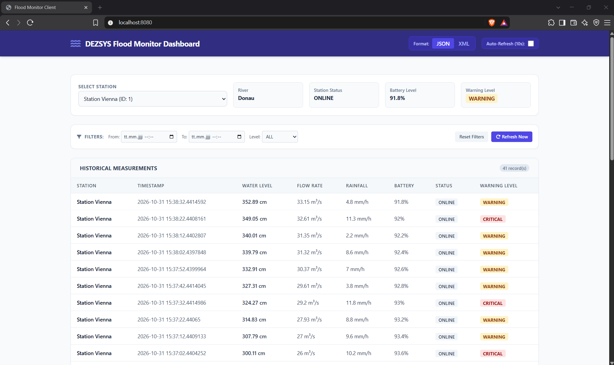

# Dokumentation Floodmonitor Martin Stättner, 4DHIT

## Architektur- und Datenmodellbeschreibung
### Archtitektur
StationController (Package controller) nimmt HTTP-Anfragen entgegen und gibt XML oder JSON, je nachdem was verlangt wird/man möchte, zurück. SimulationService erzeugt die Stationen, Messwerte, berechnet die Warnstufen, er simuliert alles (Package service). Dies gesschiet zusammen mit den anderen Klassen im model Package, wo unter anderem Daten gefiltert und Statistiken berechnet werden.
Exceptions werden dann vom ExceptionHandler im Exception-Package gehandelt. Im config package wird die Dokumentation der API festgelegt.

### Datenmodell
Im Package repository findet sich das Repository für die Stations. Diese Stations beinhalten eine ID, einen Namen, Fluss usw.. Der Standort wird in Location gespeichert. Jede Station besitzt außerdem ein Measurement-Objekt mit seiner Messhistorie. In StationAlert sieht man die neueste Messung und die entsprechende Warnstufe. In der MeasurementStatistics stehen Statistiken zu den Messungen.

## Simulationsregeln
Alle 10 sek werden neue Messwerte für die Station erstellt (einstellbar in der application.properties). Als Basis werden die vorherigen Messwerte verwendet. Des weiteren werden die Warnstufen und der Batteriezustand (MAINTENANCE bei < 10 %) berücksichtigt.
Die Vorgaben aus der Angabe habe ich berücksichtigt:
- Wasserstände dürfen nicht negativ sein.
- Der Akkustand liegt zwischen 0 und 100 Prozent.
- Starker Niederschlag soll den Wasserstand tendenziell erhöhen.
- Ein höherer Wasserstand soll zu einer höheren Durchflussmenge führen.
- Der Wasserstand soll sich zwischen zwei Messungen nicht völlig zufällig verändern.
- Bei sehr niedrigem Akkustand kann der Status auf MAINTENANCE wechseln.
- Für deaktivierte oder ausgefallene Stationen werden keine neuen Messungen erzeugt.

## Verwendete Regeln der Warnstufen
Die Regeln selbst wurden im Enum WarningLevel deklariert.
Die Regeln setzte ich in SimulatioinService in der Methode calculateWarningLevel.
1. Regel: Warnstufe UNKNOWN, wenn kein gültiges Wasserlevel (null) angeben ist, die Station OFFLINE oder die Station inaktiv ist
2. Regel: Warnstufe CRITITCAL, wenn der aktuelle Wasserstand größer als oder gleich wie der kritischen Wasserstand ist
3. Regel: Warnstufe CRITICAL, wenn das Wasserlevel um mehr als 15 cm pro Intervall oder der Regen mehr als 10mm/h ist under der aktuelle Wasserstand größer als oder gleich wie kritischen Wasserstand ist
4. Regel: Warnstufe WARNING, wenn der aktuelle Wasserstand größer als oder gleich wie der warnende Wasserstand ist
5. Regel: Warnstude NORMAL, wenn kein der obigen Regeln zutrifft

## Startanleitung
Gestartet wird der Floodmonitor im Verzeichnis des Projektes, in dem die build.gradle liegt mit folgenden Befehl:
```
./gradlew bootRun
```

## JSON & XML Anfragen
### JSON
Anfrage:
```
curl -X 'GET' \
  'http://localhost:8080/api/v1/stations' \
  -H 'accept: application/json'
```
Output:
```
[
  {
    "id": "1",
    "name": "Station Vienna",
    "river": "Donau",
    "location": {
      "latitude": 48.2082,
      "longitude": 16.3738
    },
    "normalWaterLevel": 150,
    "warningWaterLevel": 300,
    "criticalWaterLevel": 450,
    "active": true,
    "stationName": "Station Vienna"
  },
  {
    "id": "2",
    "name": "Station Linz",
    "river": "Donau",
    "location": {
      "latitude": 48.3069,
      "longitude": 14.2858
    },
    "normalWaterLevel": 120,
    "warningWaterLevel": 250,
    "criticalWaterLevel": 380,
    "active": true,
    "stationName": "Station Linz"
  },
  {
    "id": "3",
    "name": "Station Salzburg",
    "river": "Salzach",
    "location": {
      "latitude": 47.8095,
      "longitude": 13.055
    },
    "normalWaterLevel": 90,
    "warningWaterLevel": 190,
    "criticalWaterLevel": 290,
    "active": true,
    "stationName": "Station Salzburg"
  }
]
```
Anfrage:
```
curl -X 'GET' \
'http://localhost:8080/api/v1/alerts?river=Salzach' \
-H 'accept: application/json'
```
Output:
```
[
  {
    "stationId": "3",
    "stationName": "Station Salzburg",
    "river": "Salzach",
    "measurement": {
      "timestamp": "2026-10-31T15:34:22.4403441",
      "waterLevel": 170.69,
      "flowRate": 11.15,
      "rainfall": 9.6,
      "temperature": 15.7,
      "batteryLevel": 96.8,
      "status": "ONLINE",
      "warningLevel": "NORMAL"
    },
    "warningLevel": "NORMAL"
  }
]
```
### XML
Anfrage:
```
curl -X 'GET' \
  'http://localhost:8080/api/v1/stations' \
  -H 'accept: application/xml'
```
Output:
```
<List>
  <item>
    <id>1</id>
    <name>Station Vienna</name>
    <river>Donau</river>
    <location>
      <latitude>48.2082</latitude>
      <longitude>16.3738</longitude>
    </location>
    <normalWaterLevel>150.0</normalWaterLevel>
    <warningWaterLevel>300.0</warningWaterLevel>
    <criticalWaterLevel>450.0</criticalWaterLevel>
    <active>true</active>
    <stationName>Station Vienna</stationName>
  </item>
  <item>
    <id>2</id>
    <name>Station Linz</name>
    <river>Donau</river>
    <location>
      <latitude>48.3069</latitude>
      <longitude>14.2858</longitude>
    </location>
    <normalWaterLevel>120.0</normalWaterLevel>
    <warningWaterLevel>250.0</warningWaterLevel>
    <criticalWaterLevel>380.0</criticalWaterLevel>
    <active>true</active>
    <stationName>Station Linz</stationName>
  </item>
  <item>
    <id>3</id>
    <name>Station Salzburg</name>
    <river>Salzach</river>
    <location>
      <latitude>47.8095</latitude>
      <longitude>13.055</longitude>
    </location>
    <normalWaterLevel>90.0</normalWaterLevel>
    <warningWaterLevel>190.0</warningWaterLevel>
    <criticalWaterLevel>290.0</criticalWaterLevel>
    <active>true</active>
    <stationName>Station Salzburg</stationName>
  </item>
</List>
```
Anfrage:
```
curl -X 'GET' \
  'http://localhost:8080/api/v1/alerts?river=Salzach' \
  -H 'accept: application/xml'
```
Output:
```
<List>
  <item>
    <stationId>3</stationId>
    <stationName>Station Salzburg</stationName>
    <river>Salzach</river>
    <measurement>
      <timestamp>2026-10-31T15:36:22.4416538</timestamp>
      <waterLevel>238.29</waterLevel>
      <flowRate>18.39</flowRate>
      <rainfall>7.5</rainfall>
      <temperature>15.0</temperature>
      <batteryLevel>94.4</batteryLevel>
      <status>ONLINE</status>
      <warningLevel>WARNING</warningLevel>
    </measurement>
    <warningLevel>WARNING</warningLevel>
  </item>
</List>
```

## Webclient


## Reflexion
Dies war eine komplett neue Aufgabe für mich, deshalb war es etwas schwer mich damit auseinanderzusetzen wie alles zusammenhängt und funktioniert. Da ich aber nicht alles komplett einen KI-Agenten machen lassen habe, habe ich sehr viel bei dieser Aufgabe gelernt und fand sie sehr gut, da man an ihr nicht all zu kompliziert lernt wie APIs etc. funktionieren.